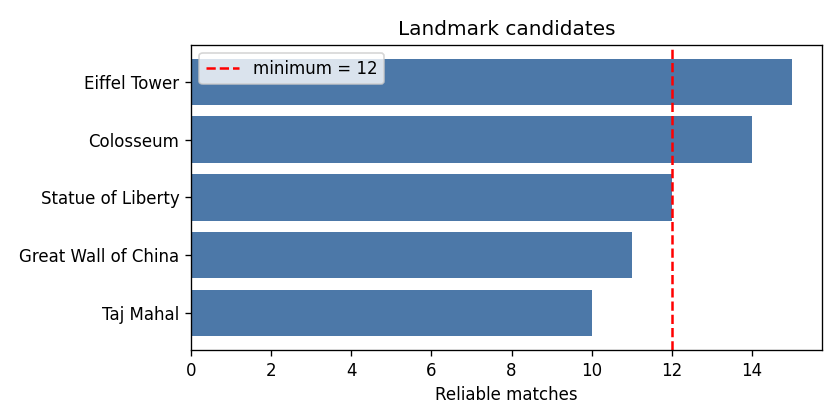
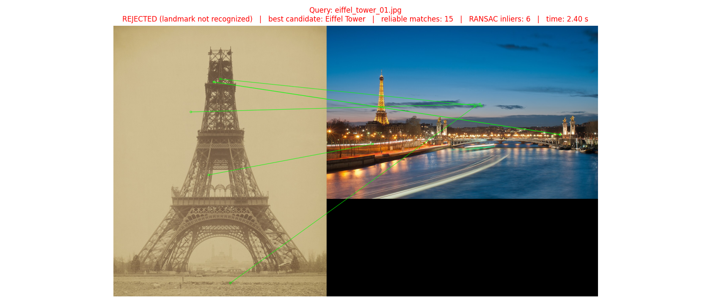

# Landmark Recognition Using SIFT

**Haider Mushtaq**
Computer Vision Laboratory 06
COMSATS University Islamabad, Wah Campus

## Abstract

This laboratory implements a local-feature pipeline for recognizing five well-known landmarks under changes in rotation, scale, brightness, and viewpoint. The project supplies 25 reference images, transformed queries for the five known classes, two unknown-landmark queries, precomputed SIFT data, and saved visual outputs. The evaluation table contains 27 queries. The system accepted five queries, all of them Taj Mahal images; it rejected the remaining 20 known-landmark queries and both unknown queries. Thus, known-landmark recognition was 5/25 (20%), while unknown rejection was 2/2. Overall `Correct=True` appears in 7/27 rows (25.9%), counting correct unknown rejections. Mean recorded processing time was 2.95 seconds per query. The high rejection rate limits practical usefulness despite avoiding false acceptance in the two unknown examples.

## 1. Introduction

A tourism information system can identify a landmark by comparing local image features in an uploaded photograph with stored reference images. SIFT describes local image structures with keypoints and descriptors designed to remain useful under scale and rotation changes. Candidate matching can be strengthened by Lowe's ratio test, while a RANSAC-estimated homography checks whether the correspondences agree with a plausible geometric mapping.

The objective of this lab is to build and evaluate that complete pipeline, including a rejection decision for images that do not produce enough reliable evidence.

## 2. Dataset and Test Design

The reference database contains five landmarks: Eiffel Tower, Taj Mahal, Great Wall of China, Statue of Liberty, and Colosseum. There are five reference images per landmark, for 25 reference images total. The test set contains five conditions per known landmark: original, 45-degree rotation, 50% resizing, reduced brightness, and a different viewpoint. Two additional images depict landmarks absent from the database: the Pyramids of Giza and Sydney Opera House.

The saved evaluation table contains 27 queries: 25 known-landmark queries and two unknown queries. The original test images are stored in `landmark_project/landmark_tests/`; the table and visualization outputs are in `landmark_project/outputs/`.

## 3. Method

The assignment specifies grayscale conversion and SIFT keypoint/descriptor extraction for the reference and query images. The feature matcher uses Euclidean descriptor distance, k-nearest-neighbor matching with k = 2, and Lowe's ratio test to remove ambiguous pairs. Reliable matches are counted and used to rank candidate landmarks. A defined threshold rejects queries without sufficient evidence, including cases where a candidate merely has the largest count but the count is still too weak.

For localization, corresponding keypoints are used to estimate a homography with RANSAC. When enough geometrically consistent matches support the estimate, the four reference-image corners can be projected into the query image. An unreliable transform should produce a rejection/message rather than a misleading polygon. The supplied outputs include keypoint, ranking, and demo figures; the project also includes the precomputed `sift_database.pkl`.

## 4. Results

### 4.1 Recognition by landmark

| Expected landmark | Queries | Recognized correctly | Recognition rate |
|---|---:|---:|---:|
| Eiffel Tower | 5 | 0 | 0% |
| Taj Mahal | 5 | 5 | 100% |
| Great Wall of China | 5 | 0 | 0% |
| Statue of Liberty | 5 | 0 | 0% |
| Colosseum | 5 | 0 | 0% |
| **Known landmarks** | **25** | **5** | **20%** |

For the Eiffel Tower, the saved outputs reject all five conditions, including the original query. The Great Wall's different-viewpoint query ranks the correct candidate first but still has too few reliable matches to pass the decision threshold. The Statue of Liberty and Colosseum queries are also rejected across all five conditions. In contrast, all five Taj Mahal queries are recognized correctly, including rotation, resizing, reduced brightness, and a different viewpoint.

The two unknown queries are both rejected, so unknown rejection is 2/2 for this small sample. Across all 27 rows, seven decisions are marked correct: five accepted Taj Mahal queries and two rejected unknown queries. This gives 25.9% total decision accuracy under the table's `Correct` column.

### 4.2 Query-level measurements

The table records keypoint counts, reliable-match counts, RANSAC inliers, and processing times for each query. The mean recorded processing time is 2.95 seconds. Processing ranged from under one second to nearly five seconds, with some queries reporting 3,000 keypoints. The full query-level measurements are preserved in [`landmark_project/outputs/results_table.csv`](landmark_project/outputs/results_table.csv).

*Figure 1. Candidate ranking generated by the supplied project.*

*Figure 2. Recognition and localization demonstration from the supplied outputs.*

## 5. Discussion

The results show a substantial gap between a candidate ranking and a successful recognition decision. For example, some non-Taj queries have a top-ranked known candidate, but the rejection rule prevents the system from treating the largest match count as proof of identity. This is useful for limiting unsupported predictions, and both unknown examples are rejected. However, the operating point is too conservative for four of the five known landmarks: the system fails to recognize even their original images in the saved evaluation.

The different-viewpoint Taj Mahal query has 1,265 reliable matches and 1,257 RANSAC inliers, consistent with a strong geometrically coherent match. Other correctly recognized Taj Mahal conditions also pass despite lower counts. The Great Wall different-viewpoint query illustrates the opposite case: its top candidate is correct, but its seven inliers do not satisfy the decision rule. Threshold calibration and reference coverage therefore have a large effect on the recognition-versus-rejection trade-off.

## 6. Limitations and Improvements

The evaluation uses only five landmarks and two unknown examples, so the unknown-rejection result is not a broad estimate. There are only five reference images per class, and viewpoint and lighting diversity may be uneven. All five correctly accepted queries belong to one class, so aggregate performance hides severe class-specific failure. The result table reports query-level metrics but does not provide repeated runs or confidence intervals.

Next steps should expand reference coverage for the four poorly recognized classes, inspect their keypoint and match visualizations, tune the match and RANSAC acceptance criteria on a separate validation set, and add many more unknown landmarks. The system should also measure localization success separately from classification, and profile runtime under a consistent machine and image-size protocol.

## 7. Conclusion

The supplied SIFT project correctly recognizes the five tested Taj Mahal conditions and rejects both unknown queries, but it recognizes none of the 20 queries for the other four known landmarks. The resulting 20% known-query recognition rate shows that this prototype needs broader reference coverage and carefully validated thresholds before it can serve as a reliable tourism recognition system.
