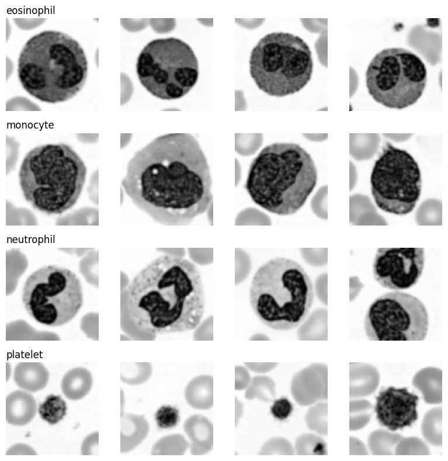
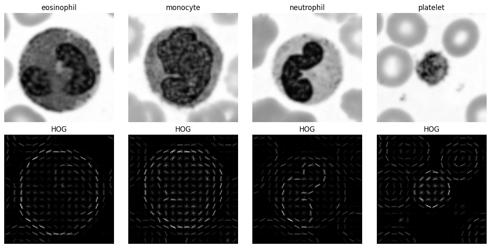
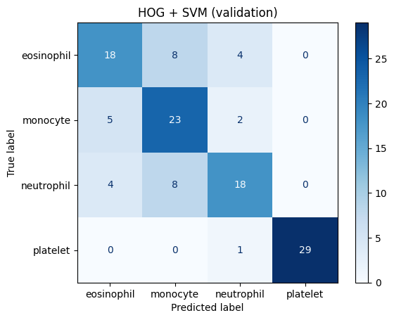
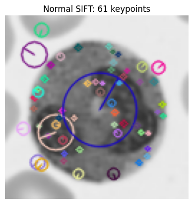
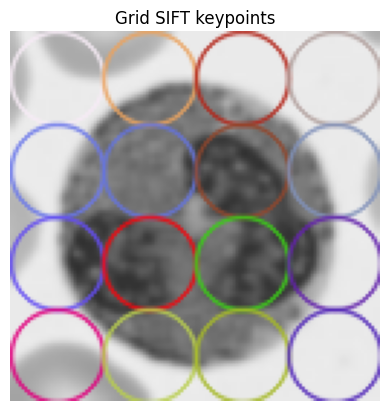
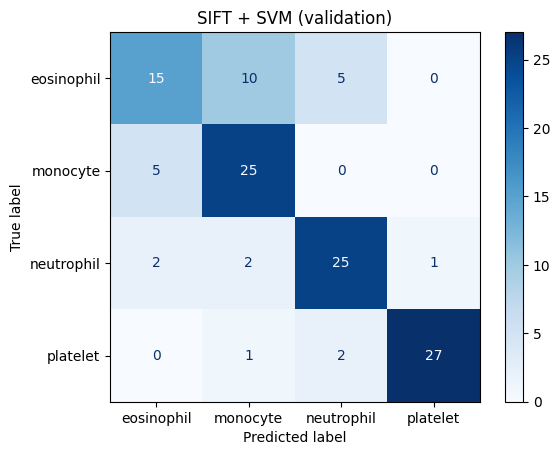
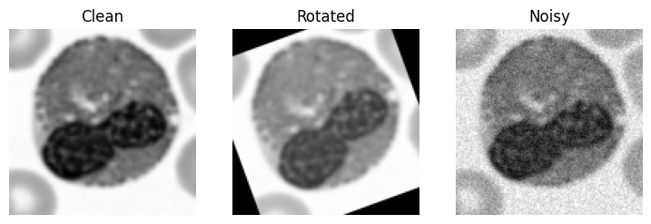
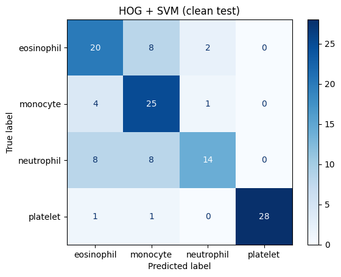
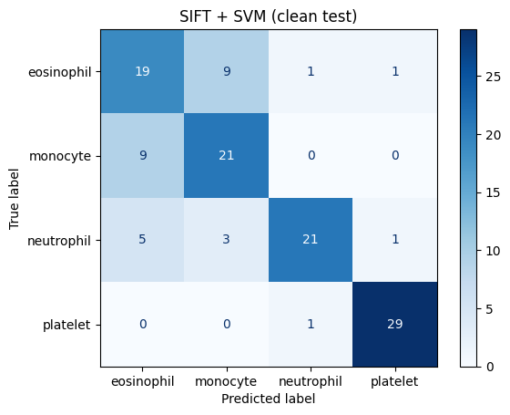

> Executed notebook [`FA23_BAI_044_HaiderMushtaq_LabMid.ipynb`](FA23_BAI_044_HaiderMushtaq_LabMid.ipynb) shown with all code and outputs. Answers PDF: [`FA23_BAI_044_HaiderMushtaq_LabMid_Answers.pdf`](FA23_BAI_044_HaiderMushtaq_LabMid_Answers.pdf)

# Lab Mid Exam: HOG vs SIFT on Blood-Cell Images
**Name:** Haider Mushtaq  
**Reg No:** FA23-BAI-044

## My Personal Settings
Last two digits of reg no 044 = **44**, last digit = **4**

| Setting | Rule | My value |
|---|---|---|
| Random seed | last two digits | 44 |
| HOG cell size | 4 is even | 8 x 8 |
| SIFT grid size | 4 is in 0 to 4 | 4 x 4 grid (16 keypoints) |

```python
# My personal settings (reg no 044)
SEED = 44
HOG_CELL = 8      # 8 x 8 pixels per cell
GRID = 4          # 4 x 4 grid = 16 SIFT keypoints
```

```python
!pip install -q medmnist opencv-python-headless scikit-image scikit-learn
```

```python
import numpy as np
import cv2
import matplotlib.pyplot as plt
from medmnist import BloodMNIST
from skimage.feature import hog
from sklearn.svm import LinearSVC
from sklearn.preprocessing import StandardScaler
from sklearn.pipeline import make_pipeline
from sklearn.metrics import accuracy_score, f1_score, confusion_matrix, ConfusionMatrixDisplay

CLASSES = [1, 5, 6, 7]
NAMES = {1: 'eosinophil', 5: 'monocyte', 6: 'neutrophil', 7: 'platelet'}
rng = np.random.default_rng(SEED)
```

## Q1. Data setup

```python
def load_split(split, n_per_class):
    data = BloodMNIST(split=split, download=True, size=64)
    imgs = data.imgs              # (N, 64, 64, 3)
    labels = data.labels.ravel()  # (N,)

    X, y = [], []
    for c in CLASSES:
        idx = np.where(labels == c)[0]
        pick = rng.choice(idx, n_per_class, replace=False)   # random pick using my seed
        for i in pick:
            gray = cv2.cvtColor(imgs[i], cv2.COLOR_RGB2GRAY)  # colour to grayscale
            gray = cv2.resize(gray, (128, 128))               # 64x64 to 128x128
            X.append(gray)
            y.append(c)
    return np.array(X), np.array(y)

X_train, y_train = load_split('train', 100)
X_val,   y_val   = load_split('val',   30)
X_test,  y_test  = load_split('test',  30)

for name, X, y in [('Train', X_train, y_train), ('Val', X_val, y_val), ('Test', X_test, y_test)]:
    counts = {NAMES[c]: int((y == c).sum()) for c in CLASSES}
    print(name, X.shape, counts)
```

**Output:**
```
Train (400, 128, 128) {'eosinophil': 100, 'monocyte': 100, 'neutrophil': 100, 'platelet': 100}
Val (120, 128, 128) {'eosinophil': 30, 'monocyte': 30, 'neutrophil': 30, 'platelet': 30}
Test (120, 128, 128) {'eosinophil': 30, 'monocyte': 30, 'neutrophil': 30, 'platelet': 30}
```

```python
# 4 example images per class (one row per class)
fig, axes = plt.subplots(4, 4, figsize=(8, 8))
for r, c in enumerate(CLASSES):
    idx = np.where(y_train == c)[0][:4]
    for k, i in enumerate(idx):
        axes[r, k].imshow(X_train[i], cmap='gray')
        axes[r, k].axis('off')
    axes[r, 0].set_title(NAMES[c], loc='left')
plt.tight_layout()
plt.show()
```



## Q2. HOG + SVM

```python
def hog_features(images):
    feats = []
    for img in images:
        f = hog(img, orientations=9,
                pixels_per_cell=(HOG_CELL, HOG_CELL),
                cells_per_block=(2, 2))
        feats.append(f)
    return np.array(feats)

H_train = hog_features(X_train)
H_val   = hog_features(X_val)
print('HOG feature length:', H_train.shape[1])
```

**Output:**
```
HOG feature length: 8100
```

**HOG length by hand (cell 8 x 8):**
- Cells per side = 128 / 8 = 16
- Blocks per side (block = 2 x 2 cells, moves 1 cell at a time) = 16 - 2 + 1 = 15
- Total blocks = 15 x 15 = 225
- Values per block = 2 x 2 cells x 9 orientations = 36
- Feature length = 225 x 36 = **8100**

```python
# HOG picture for one image from each class
fig, axes = plt.subplots(2, 4, figsize=(12, 6))
for k, c in enumerate(CLASSES):
    img = X_train[np.where(y_train == c)[0][0]]
    _, hog_img = hog(img, orientations=9, pixels_per_cell=(HOG_CELL, HOG_CELL),
                     cells_per_block=(2, 2), visualize=True)
    axes[0, k].imshow(img, cmap='gray');     axes[0, k].set_title(NAMES[c])
    axes[1, k].imshow(hog_img, cmap='gray'); axes[1, k].set_title('HOG')
    axes[0, k].axis('off'); axes[1, k].axis('off')
plt.tight_layout()
plt.show()
```



```python
def train_svm(F_train, y_train, F_val, y_val, title):
    best_acc, best_C, best_model = -1, None, None
    for C in [0.1, 1, 10]:
        model = make_pipeline(StandardScaler(), LinearSVC(C=C, max_iter=10000, random_state=SEED))
        model.fit(F_train, y_train)
        acc = accuracy_score(y_val, model.predict(F_val))
        print(f'C = {C}: validation accuracy = {acc:.3f}')
        if acc > best_acc:
            best_acc, best_C, best_model = acc, C, model

    pred = best_model.predict(F_val)
    print(f'\nBest C = {best_C}')
    print(f'Validation accuracy = {accuracy_score(y_val, pred):.3f}')
    print(f'Validation macro-F1 = {f1_score(y_val, pred, average="macro"):.3f}')

    cm = confusion_matrix(y_val, pred, labels=CLASSES)
    ConfusionMatrixDisplay(cm, display_labels=[NAMES[c] for c in CLASSES]).plot(cmap='Blues')
    plt.title(title + ' (validation)')
    plt.show()
    return best_model

hog_model = train_svm(H_train, y_train, H_val, y_val, 'HOG + SVM')
```

**Output:**
```
C = 0.1: validation accuracy = 0.733
C = 1: validation accuracy = 0.733
C = 10: validation accuracy = 0.733

Best C = 0.1
Validation accuracy = 0.733
Validation macro-F1 = 0.734
```



## Q3. SIFT + SVM

```python
sift = cv2.SIFT_create()

# Normal SIFT detection on training images
counts = []
for img in X_train:
    kp, des = sift.detectAndCompute(img, None)
    counts.append(len(kp))
counts = np.array(counts)

print('Average keypoints per image:', round(counts.mean(), 2))
print('Minimum keypoints:', counts.min())
print('Maximum keypoints:', counts.max())
print('Images with zero keypoints:', (counts == 0).sum())

# Draw keypoints on one image
kp, _ = sift.detectAndCompute(X_train[0], None)
drawn = cv2.drawKeypoints(X_train[0], kp, None, flags=cv2.DRAW_MATCHES_FLAGS_DRAW_RICH_KEYPOINTS)
plt.imshow(drawn); plt.title(f'Normal SIFT: {len(kp)} keypoints'); plt.axis('off'); plt.show()
```

**Output:**
```
Average keypoints per image: 70.67
Minimum keypoints: 10
Maximum keypoints: 240
Images with zero keypoints: 0
```



**Why is this a problem for SVM?** An SVM needs every image to give a feature vector of the same length, but with normal SIFT each image gives a different number of keypoints (some give zero), so the descriptors cannot be stacked into one fixed size vector.

```python
# Fixed grid of keypoints: 4 x 4 grid over 128 x 128 image
step = 128 // GRID                              # 32 pixels between points
centers = [step // 2 + i * step for i in range(GRID)]   # 16, 48, 80, 112
grid_kp = [cv2.KeyPoint(float(x), float(y), 32) for y in centers for x in centers]

def sift_features(images):
    feats = []
    for img in images:
        _, des = sift.compute(img, grid_kp)   # des shape = (16, 128)
        feats.append(des.flatten())           # join into one vector
    return np.array(feats)

S_train = sift_features(X_train)
S_val   = sift_features(X_val)
print('Grid points:', len(grid_kp))
print('SIFT feature length:', S_train.shape[1])

drawn = cv2.drawKeypoints(X_train[0], grid_kp, None, flags=cv2.DRAW_MATCHES_FLAGS_DRAW_RICH_KEYPOINTS)
plt.imshow(drawn); plt.title('Grid SIFT keypoints'); plt.axis('off'); plt.show()
```

**Output:**
```
Grid points: 16
SIFT feature length: 2048
```



**SIFT length by hand (4 x 4 grid):**
- Grid points = 4 x 4 = 16
- Each SIFT descriptor = 4 x 4 sub-regions x 8 orientation bins = 128
- Feature length = 16 x 128 = **2048**

```python
sift_model = train_svm(S_train, y_train, S_val, y_val, 'SIFT + SVM')
```

**Output:**
```
C = 0.1: validation accuracy = 0.758
C = 1: validation accuracy = 0.767
C = 10: validation accuracy = 0.767

Best C = 1
Validation accuracy = 0.767
Validation macro-F1 = 0.762
```



## Q4. Robustness

```python
def rotate(images, angle=20):
    M = cv2.getRotationMatrix2D((64, 64), angle, 1.0)   # rotate around the centre
    return np.array([cv2.warpAffine(img, M, (128, 128)) for img in images])

def add_noise(images, sigma=0.05):
    noise_rng = np.random.default_rng(SEED)
    x = images / 255.0                                   # scale to 0 to 1
    x = x + noise_rng.normal(0, sigma, x.shape)          # add Gaussian noise
    x = np.clip(x, 0, 1)
    return (x * 255).astype(np.uint8)

test_sets = {'Clean': X_test, 'Rotated': rotate(X_test), 'Noisy': add_noise(X_test)}

# show what the changed test images look like
fig, axes = plt.subplots(1, 3, figsize=(9, 3))
for ax, (name, X) in zip(axes, test_sets.items()):
    ax.imshow(X[0], cmap='gray'); ax.set_title(name); ax.axis('off')
plt.show()
```



```python
# Models are frozen: we only call predict, no training here
results = {'HOG + SVM': {}, 'SIFT + SVM': {}}
for name, X in test_sets.items():
    results['HOG + SVM'][name]  = accuracy_score(y_test, hog_model.predict(hog_features(X)))
    results['SIFT + SVM'][name] = accuracy_score(y_test, sift_model.predict(sift_features(X)))

print(f"{'Model':<12}{'Clean':>10}{'Rotated':>10}{'Noisy':>10}")
for model_name, r in results.items():
    print(f"{model_name:<12}{r['Clean']:>10.3f}{r['Rotated']:>10.3f}{r['Noisy']:>10.3f}")
```

**Output:**
```
Model            Clean   Rotated     Noisy
HOG + SVM        0.725     0.658     0.250
SIFT + SVM       0.750     0.467     0.750
```

**Results table (numbers from the output above):**

| Model | Clean accuracy | Rotated accuracy | Noisy accuracy |
|---|---|---|---|
| HOG + SVM | 0.725 | 0.658 | 0.250 |
| SIFT + SVM | 0.750 | 0.467 | 0.750 |

**Was my prediction correct?**  
My noise prediction was correct: HOG fell from 0.725 to 0.250, which is chance level for four classes, while SIFT stayed at 0.750. My rotation prediction was wrong: HOG only dropped from 0.725 to 0.658 (6.7 points) but SIFT dropped from 0.750 to 0.467 (28.3 points). A likely reason is that my 16 grid keypoints have fixed positions and a fixed orientation, so after a 20 degree turn every large patch (including the four corner patches that now hold black fill) describes different content, while for noise SIFT computes each size 32 descriptor on a blurred level of the image, which smooths the noise away.

```python
# Confusion matrices on clean test set (helps answer Q5 part 2)
for model, F, title in [(hog_model, hog_features(X_test), 'HOG + SVM'),
                        (sift_model, sift_features(X_test), 'SIFT + SVM')]:
    cm = confusion_matrix(y_test, model.predict(F), labels=CLASSES)
    ConfusionMatrixDisplay(cm, display_labels=[NAMES[c] for c in CLASSES]).plot(cmap='Blues')
    plt.title(title + ' (clean test)')
    plt.show()
```





## Q5. Short answers and AI log

**(a) Why does HOG use block normalisation?**  
Lighting and stain contrast change from image to image, so the same cell shape can give strong gradients in one image and weak ones in another. Block normalisation divides the histograms of each 2 x 2 block by their overall size, so the feature describes the shape of the edges and not how bright or dark the image is. Because blocks overlap, each cell gets normalised several times against different neighbours, which makes the feature more stable.

**(b) Why is it wrong to choose C using the test set?**  
If we pick C by looking at test accuracy, the test set has been used to tune the model, so the reported test score is too optimistic. The test set has to stay unseen until the end so it gives an honest estimate of performance on new images, which is why C was chosen on the validation set and the test set was only used in Q4.

**Which two classes were confused most, and why might grayscale make this harder?**  
Both models confused eosinophil and monocyte the most. On the clean test set HOG predicted 8 eosinophils as monocytes and 4 monocytes as eosinophils, and SIFT made the same mistake 9 times in each direction (validation shows the same pair: 8 + 5 for HOG and 10 + 5 for SIFT). Grayscale makes this harder because the main clue between them is colour: eosinophils have bright orange red granules from the eosin stain while monocytes have pale blue grey cytoplasm. In grayscale both become a round grey cell with a large dark nucleus of similar size, so only the nucleus shape and texture is left to separate them.
